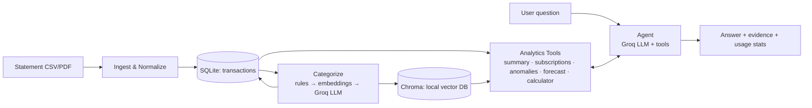

# 🕵️ Finance Detective (AI core)

An AI agent that reads your bank statements and tells you where your money actually goes: it categorizes spending, finds forgotten subscriptions, flags suspicious charges, and answers questions like *"Can I afford a ₹50,000 trip in December?"* using real calculations, not guesses.

> **Scope of this repo (for now):** the **AI part only**. No frontend, no web backend. You interact through a CLI and Python functions. The code is structured so a FastAPI backend and any frontend can be bolted on later without rewriting anything. See [`docs/GUIDE.md`](docs/GUIDE.md) section 13.

---

## Documents

| File | What it is |
|---|---|
| [`README.md`](README.md) | This file: overview, quickstart, structure |
| [`docs/PRD.md`](docs/PRD.md) | Product requirements: what we're building, for whom, and how we know it works |
| [`docs/GUIDE.md`](docs/GUIDE.md) | Full build guide: architecture, flow, step-by-step phases, code skeletons, pitfalls |

**Read order:** README → PRD → GUIDE, then start building at GUIDE Phase 0.

---

## What it can do

- 📥 **Ingest** bank statements (CSV and text-based PDF) from different banks via column "profiles"
- 🧹 **Clean** messy merchant names (`AMZN MKTP IN*2K4..` → `Amazon`)
- 🏷️ **Categorize** transactions (rules → embedding similarity → LLM fallback)
- 🔁 **Detect subscriptions** and recurring payments, including price hikes and dead subscriptions
- 🚩 **Flag anomalies**: duplicate charges, unusually large amounts, new merchants, fees
- 💬 **Answer questions** in natural language, with **evidence** (the exact transactions behind every number)
- 🔮 **Affordability checks**: "can I afford X by date Y?" with explicit assumptions

## Key design principle

> **The LLM never does math and never "remembers" your data. Tools do the math; the LLM decides which tool to call and explains the result.**

Numbers come from deterministic Python (pandas/SQLite). The LLM is used only for what it's good at: understanding messy text, choosing tools, and writing clear answers.

---

## Architecture at a glance



## Tech stack

| Layer | Choice | Why |
|---|---|---|
| LLM | **Groq API** (`langchain-groq`) | Very fast inference, free tier, tool-calling support |
| Orchestration | **LangChain** + **LangGraph** | Runnables, tools, agents (what you just studied) |
| Embeddings | `sentence-transformers` (local, via `langchain-huggingface`) | Groq doesn't offer embeddings; local = free + private |
| Vector DB | **Chroma** (persistent, local folder) | Free, zero setup, plays nicely with LangChain |
| Structured data | **SQLite + pandas** | Exact numbers; no vector DB can sum a column |
| PDF parsing | `pdfplumber` | Good table extraction for text-based PDFs |
| Validation | **Pydantic** | Typed schemas for transactions and LLM outputs |
| Tests | `pytest` | Unit tests + eval harness |

---

## Quickstart

### 1. Prerequisites
- Python 3.10+
- A free Groq API key from <https://console.groq.com>

### 2. Setup
```bash
git clone <your-repo-url> fin-detective
cd fin-detective

python -m venv .venv
source .venv/bin/activate          # Windows: .venv\Scripts\activate

pip install -r requirements.txt
cp .env.example .env               # then paste your GROQ_API_KEY into .env
```

### 3. Generate fake data (never start with real statements)
```bash
python scripts/generate_synthetic_data.py --months 12 --out data/samples/demo.csv
```

### 4. Run
```bash
python -m fin_detective.cli ingest data/samples/demo.csv --profile generic
python -m fin_detective.cli categorize
python -m fin_detective.cli ask "How much did I spend on food last month?"
python -m fin_detective.cli ask "Which subscriptions am I still paying for?"
python -m fin_detective.cli ask "Can I afford a 60000 trip in December?"
```

### 5. Evaluate
```bash
pytest
python eval/run_eval.py
```

---

## Project structure

```
fin-detective/
├── README.md
├── docs/
│   ├── PRD.md
│   └── GUIDE.md
├── requirements.txt
├── .env.example
├── .gitignore                    # must include .env and data/
├── src/fin_detective/
│   ├── config.py                 # settings loaded from .env
│   ├── schemas.py                # Pydantic models (Transaction, AskResponse, ...)
│   ├── ingest/                   # csv_loader.py, pdf_loader.py, normalize.py, profiles/
│   ├── store/                    # db.py (SQLite), vectors.py (Chroma)
│   ├── categorize/               # rules.py, llm_labeler.py, pipeline.py
│   ├── analytics/                # summary.py, subscriptions.py, anomalies.py, forecast.py
│   ├── tools/                    # LangChain @tool wrappers around analytics
│   ├── agent/                    # prompts.py, build.py, service.py (public API)
│   └── cli.py
├── scripts/generate_synthetic_data.py
├── tests/
├── eval/                         # golden_questions.yaml, run_eval.py
└── data/                         # gitignored: sqlite db, chroma folder, samples
```

## Configuration (`.env`)

```env
GROQ_API_KEY=your_key_here
AGENT_MODEL=llama-3.3-70b-versatile       # check console.groq.com for current model names
CATEGORIZER_MODEL=llama-3.1-8b-instant    # smaller/cheaper model for bulk labeling
EMBEDDING_MODEL=sentence-transformers/all-MiniLM-L6-v2
DATA_DIR=data
CURRENCY_SYMBOL=₹
```

> Model names and free-tier rate limits on Groq change over time. Always check the Groq console/docs and update `.env` rather than hardcoding names in code.

---

## Privacy & safety

- Statements are stored **only on your machine** (SQLite + Chroma in `data/`).
- Anything the LLM sees **is sent to Groq's servers**. The code redacts account numbers and personal names before any LLM call, and tools return **summaries and capped rows**, never the whole statement. Understand this before using real data.
- Merchant descriptions are **untrusted text** (a malicious description could say "ignore previous instructions"). All tools are **read-only**, and the system prompt treats descriptions as data.
- This is a learning project, **not financial advice**.

## Roadmap

- [ ] Phase 0–7 AI core (see GUIDE)
- [ ] FastAPI backend wrapping `FinanceAgent.ask()` (streaming)
- [ ] Frontend (chat + charts)
- [ ] Persistent conversation memory
- [ ] Budget goals and proactive monthly "insight digest"
- [ ] OCR for scanned PDFs

